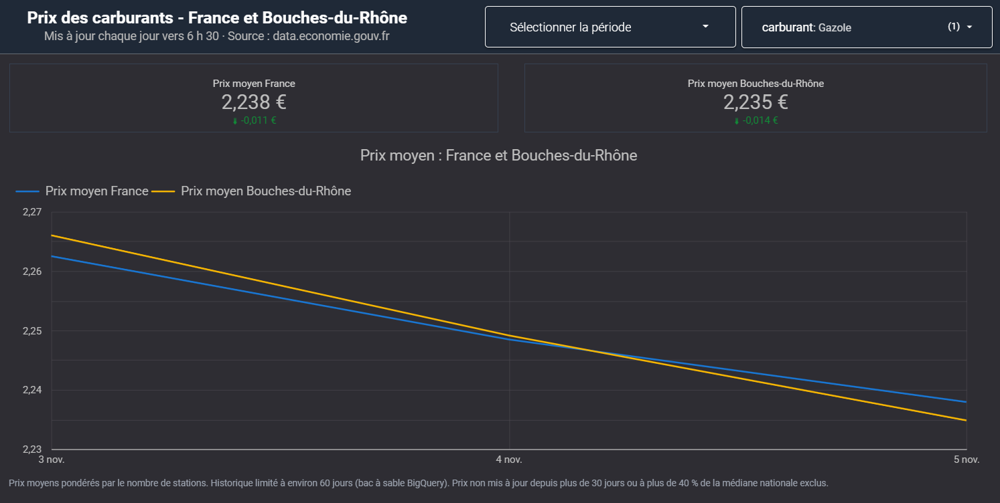
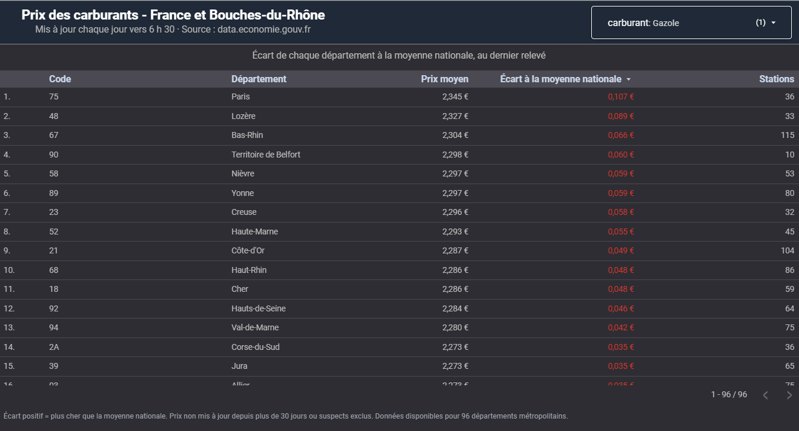
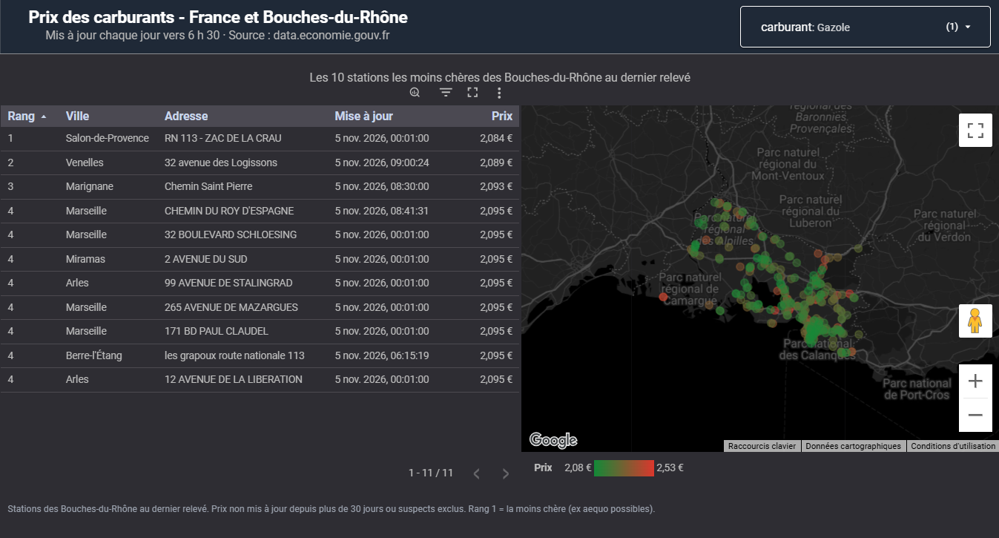
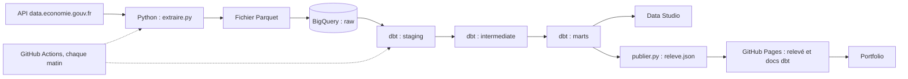
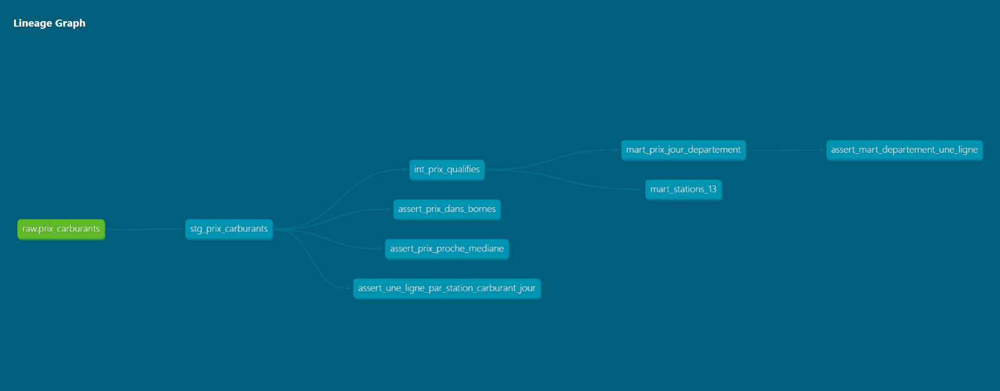

# Pipeline des prix des carburants en France


Pipeline de données automatisé qui récupère chaque matin les prix des carburants des ~9 800 stations-service françaises, les charge dans BigQuery, les nettoie et les teste avec dbt, puis les publie dans un tableau de bord Data Studio.

**[Voir le tableau de bord](https://datastudio.google.com/reporting/77d153bb-1926-4ad1-a366-4deee23bc762)** - mis à jour chaque jour vers 6 h 30.

Le pipeline publie aussi chaque matin la [documentation dbt](https://remydaura.github.io/DE-Pipeline-Prix-Carburants/) et un [relevé du jour](https://remydaura.github.io/DE-Pipeline-Prix-Carburants/releve.json), affiché sur la page d'accueil de [mon portfolio](https://remydaura.github.io).

| Évolution | Départements | Marseille |
| :---: | :---: | :---: |
|  |  |  |

---

## Le problème

Les prix à la pompe changent tous les jours et varient fortement d'un département à l'autre. Les données sont publiques, mais brutes : un instantané qui écrase le précédent, des stations qui ne mettent plus leurs prix à jour, des erreurs de saisie et des champs manquants.

Ce projet transforme ce flux en un historique fiable et testé, pour répondre à trois questions :

- Comment évolue le prix moyen de chaque carburant, en France et dans les Bouches-du-Rhône ?
- Quels départements sont les plus chers ou les moins chers par rapport à la moyenne nationale ?
- Quelles sont les stations les moins chères autour de Marseille aujourd'hui ?

## Architecture



| Étape | Outil | Ce qu'elle fait |
| --- | --- | --- |
| Ingestion | Python (requests, pandas) | Télécharge toutes les stations, garde 24 colonnes, ajoute l'heure d'extraction, écrit un fichier Parquet |
| Chargement | BigQuery (load job) | Ajoute le fichier à une table brute partitionnée par jour, sans jamais modifier l'existant |
| Staging | dbt (vue) | Garde le dernier relevé du jour par station, passe à une ligne par station et par carburant, convertit les types, complète les départements manquants |
| Intermediate | dbt (vue) | Étiquette chaque prix : récent ou périmé, normal ou suspect |
| Marts | dbt (tables) | Prix par jour, département et carburant ; classement des stations des Bouches-du-Rhône |
| Orchestration | GitHub Actions + cron-job.org | Lance tests, ingestion, chargement et dbt chaque matin à 6 h 17, déclenché par un service externe via l'API GitHub |
| Conteneur | Docker | Image légère de l'ingestion, qui tourne à l'identique sur n'importe quelle machine |
| Restitution | Data Studio | Tableau de bord public en 3 pages |
| Publication | Python + GitHub Pages | Calcule le relevé du jour (moyennes France et Bouches-du-Rhône, nombre de tests passés), vérifie son contrat de données, puis le publie avec la documentation dbt |


Le graphe des modèles dbt, généré par `dbt docs` :



## Stack

Python 3.12 · pandas · pyarrow · pytest · Google BigQuery · dbt Core 1.12 · GitHub Actions · Docker · Data Studio · ruff

## Qualité des données

La qualité est contrôlée à chaque run, et un test bloquant arrête le pipeline avant que des données fausses n'arrivent dans le tableau de bord.

**Tests Python (pytest)** : sélection des colonnes, aplatissement des champs imbriqués, arrêt immédiat si la source supprime une colonne ; pour le relevé publié, comptage des tests dbt, ordre des carburants et contrat de données (prix entre 0,30 et 4,00 €, aucun carburant manquant). Le code est aussi vérifié par le linter `ruff` à chaque run.

**Tests dbt** (15 tests) :

| Test | Niveau | Ce qu'il vérifie |
| --- | --- | --- |
| `not_null` | Bloquant | Identifiant, jour, carburant, prix et date de mise à jour toujours renseignés |
| `accepted_values` | Bloquant | Seulement les 6 carburants connus (Gazole, SP95, SP98, E10, E85, GPLc) |
| Une ligne par station, carburant et jour | Bloquant | Le dédoublonnage fonctionne même si le pipeline tourne plusieurs fois dans la journée |
| Prix entre 0,30 et 4,00 €/L | Bloquant | Aucune valeur impossible (erreur de format, prix en centimes) |
| Une ligne par jour, département et carburant | Bloquant | Pas de doublon dans le mart départemental |
| Prix à moins de 40 % de la médiane nationale | Avertissement | Signale les saisies douteuses sans bloquer le pipeline |
| Fraîcheur de la source | Avertissement / erreur | Prévient si aucune station n'a publié de nouveau prix du gazole depuis 24 h (flux bloqué), échoue après 48 h |

**Ce que les tests ont permis de trouver**, sur le premier relevé (3 novembre 2026, 30 470 prix) :

- **17 prix suspects**, par exemple de l'E85 affiché à 1,99 € alors que la moyenne nationale est d'environ 0,90 €.
- **4 stations sans département ni ville** dans la source. Leur département est retrouvé à partir du code postal, et une colonne `departement_deduit_du_cp` garde la trace de la correction.
- **Des prix périmés** : 16 % des prix n'avaient pas été mis à jour depuis plus de 7 jours, et 5,6 % depuis plus de 30 jours. Le seuil retenu est de 30 jours, choisi à partir de la distribution réelle de l'ancienneté des prix.

## Choix techniques et limites

- **BigQuery en mode bac à sable (gratuit, sans carte bancaire).** Conséquences : chargement par load job (le streaming et le DML sont interdits), marts recréés en entier à chaque run plutôt qu'en incrémental (`MERGE` est interdit), et un historique glissant d'environ 60 jours, car les partitions expirent automatiquement.
- **La table brute garde tout.** Si le pipeline tourne deux fois le même jour, les deux relevés sont conservés, et c'est la couche staging qui ne garde que le plus récent. Rien n'est jamais modifié ni supprimé à la main.
- **Les calculs sont faits dans l'entrepôt, pas dans l'outil de visualisation.** Les moyennes nationales et les écarts au national sont calculés dans dbt, à partir des sommes exactes, pour éviter les erreurs d'arrondi et les moyennes de moyennes.
- **Les règles métier sont paramétrables.** Le seuil de 30 jours est une variable dbt (`jours_max_depuis_maj` dans `dbt_project.yml`).
- **Aucun secret dans le dépôt.** En local, l'authentification passe par gcloud, sans fichier de clé. Dans GitHub Actions, la clé d'un compte de service limité à BigQuery est stockée dans les secrets du dépôt.
- **Couverture** : les données disponibles couvrent 96 départements métropolitains.
- **Un déclencheur externe.** Le planificateur intégré de GitHub Actions ne lançait pas les runs programmés de ce dépôt (aucun run en plus d'une heure de test, avec un workflow valide). Le pipeline est donc déclenché chaque matin par cron-job.org, via l'API GitHub, avec un jeton limité au lancement des workflows de ce seul dépôt.
## Structure du dépôt

```text
.
├── .github/workflows/pipeline.yml   Orchestration quotidienne
├── ingestion/
│   ├── explorer.py                  Aperçu des champs de l'API
│   ├── extraire.py                  Téléchargement et écriture Parquet
│   ├── charger.py                   Chargement dans BigQuery
│   └── publier.py                   Relevé du jour publié sur GitHub Pages
├── tests/                           Tests Python (extraction, relevé)
├── dbt/
│   ├── models/staging/              Nettoyage et dédoublonnage
│   ├── models/intermediate/         Étiquetage des prix
│   ├── models/marts/                Tables du tableau de bord
│   └── tests/                       Tests SQL sur mesure
├── ci/profiles.yml                  Profil dbt de GitHub Actions (sans secret)
├── Dockerfile                       Image de l'ingestion
├── requirements-ingestion.txt       Dépendances de l'ingestion
└── requirements.txt                 Dépendances complètes (ingestion, tests, dbt)
```

## Lancer le projet

Prérequis : Python 3.12, Git, Google Cloud CLI et un projet Google Cloud avec BigQuery.

```bash
git clone https://github.com/RemyDaura/DE-Pipeline-Prix-Carburants.git
cd DE-Pipeline-Prix-Carburants
python -m venv .venv
source .venv/bin/activate          # Windows : .\.venv\Scripts\Activate.ps1
pip install -r requirements.txt

gcloud auth application-default login
bq --location=EU mk --dataset VOTRE_PROJET:raw
export GCP_PROJECT_ID=VOTRE_PROJET # Windows : $env:GCP_PROJECT_ID = "VOTRE_PROJET"

python -m pytest
python -m ingestion.extraire
python -m ingestion.charger

cd dbt
dbt build
```

Le profil dbt local (`~/.dbt/profiles.yml`) se crée avec `dbt init` : méthode `oauth`, dataset `dbt_dev`, location `EU`.

Avec Docker, pour l'ingestion seule :

```bash
docker build -t carburants-ingestion .
docker run --rm -v "$(pwd)/data:/app/data" carburants-ingestion
```

## Prochaines étapes

- Remplacer la clé du compte de service par Workload Identity Federation, pour une authentification sans aucune clé stockée.
- Faire tourner l'ingestion sur Cloud Run Jobs avec l'image Docker, déclenchée par Cloud Scheduler.
- Ajouter un assistant qui répond en langage naturel aux questions sur les prix, en générant du SQL sur les marts.

## Source des données

[Prix des carburants en France - Flux instantané - v2](https://www.data.gouv.fr/fr/datasets/6407d088d4e23dc662022e2c), publié par la DGCCRF et diffusé par les Ministères économiques et financiers, sous [Licence Ouverte / Open Licence version 2.0](https://www.etalab.gouv.fr/licence-ouverte-open-licence/).

## Auteur

Rémy D'Aura, data analyst en spécialisation data engineering · [Portfolio](https://remydaura.github.io) · [LinkedIn](https://www.linkedin.com/in/r%C3%A9my-d-aura/)
